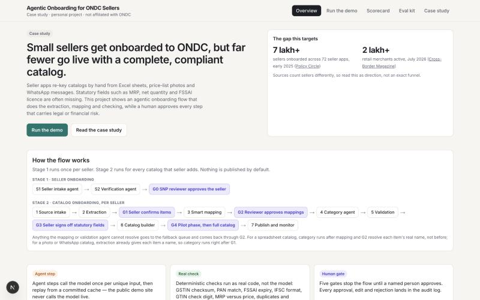
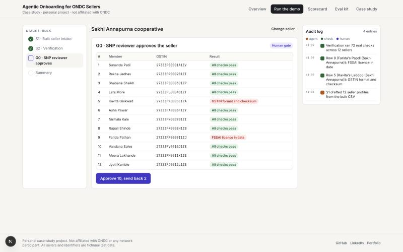
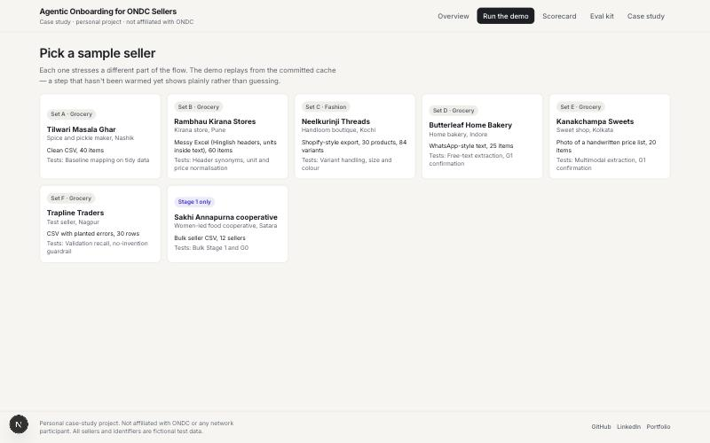
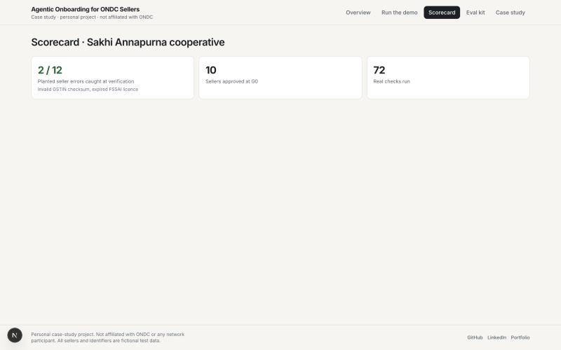

# Agentic Onboarding for ONDC Sellers

Personal case-study project. Not affiliated with ONDC or any network participant.
All sellers and identifiers are fictional test data.

Full PRD: [docs/PRD.md](docs/PRD.md) (readable copy, with diagrams; `reference/PRD.docx` is the source).

**Live:** [agentic-onboarding-ondc.vercel.app](https://agentic-onboarding-ondc.vercel.app)



## The problem

Small sellers get onboarded to ONDC through seller apps, but far fewer go live with a
complete, compliant catalog. Seller apps re-key catalogs by hand from Excel sheets,
price-list photos and WhatsApp messages, and statutory fields such as MRP, net quantity
and FSSAI licence are often missing. This project shows an agentic onboarding flow that
does the extraction, mapping and checking, while a human approves every step that
carries legal or financial risk.

## The approach

A two-stage flow runs under one orchestrator:

- **Stage 1** (once per seller): seller intake agent, verification agent, gate G0
  (seller app reviewer approves the seller). Supports bulk onboarding from one CSV.
- **Stage 2** (per catalog): source intake, extraction, gate G1 (seller confirms
  extracted items, for photo and text sources), smart mapping agent, gate G2 (reviewer
  approves risky mappings, plus the fallback queue), category agent, validation, gate
  G3 (seller signs off statutory fields, including a branded item's pack-label packer
  details), catalog builder, gate G4 (pilot phase, then full catalog), publish to a mock
  seller app and monitor. For a spreadsheet catalog, category runs after mapping/G2
  resolve the item's real name; for a photo or WhatsApp catalog, extraction already
  gives each item a name, so category runs right after G1.

Mappings route by confidence and field risk: low-risk fields at 0.90 or above are
auto-accepted, high-risk fields (prices, net quantity, FSSAI, packer, veg mark, return
terms) always go to a human, and anything below 0.60 goes to a fallback queue. An agent
never invents a statutory value — it may only extract it from the source, pre-fill it
from the approved seller profile, or ask the seller. An item with no brand, or one of
the seller's own brands, is pre-filled from the profile; an item carrying someone
else's brand is never defaulted to the seller — it is flagged at G3 for the seller to
enter that brand owner's packer details from the pack label.

## Run once, replay forever

Model calls are expensive, so every agent step runs once per unique input and is
replayed after that:

- A step output cache, keyed by a hash of the step name, prompt version, schema
  version, model ID and the normalised input.
- A column-level cache for mapping decisions.
- Mapping templates saved per source format fingerprint once a reviewer approves them
  at G2.
- Human decisions are never cached — they are recorded per run in the audit log.

The deployed public site runs in demo mode: every sample-set agent step replays from a
committed cache (see `data/cache/`), so it needs no API key and spends no tokens. Live
mode (owner only) runs real model calls behind a passphrase and rate limit.

A finished demo run also needs to persist its state between finishing Stage 1 and
opening its scorecard (`/scorecard?run=<id>`), which happens as separate requests to a
serverless function with no shared, writable filesystem. In production this run-state
store, and the agent cache if live mode writes to it, use Upstash Redis
(`UPSTASH_REDIS_REST_URL`/`UPSTASH_REDIS_REST_TOKEN`); locally and in tests they fall
back to committed or temp-dir JSON files.



## The demo and scorecard

`/demo` picks a sample seller or the bulk set, then walks every agent step and gate
with the timeline on the left, the step in the middle and the audit log on the right.
`/scorecard` scores the finished run against ground truth.



Set G (bulk Stage 1, fully deterministic, no model needed) runs end to end with no
warming required, and is covered by the Playwright suite:



Sets B, C, D, E and F also need a model step (seller intake, mapping or category), so on
a deployment with no `ANTHROPIC_API_KEY` ever used, those steps show an honest "not
warmed yet" card instead of a live call or a fabricated result. Run `agents:warm` locally
with your own key to populate `data/cache/` and commit it (see below); once warmed, the
full-catalog metrics (auto-accept precision, auto-map rate, fallback rate, set F's
planted-error recall, invented statutory values, which must stay 0) show on the
scorecard the same way.

## Status

This repo is being built milestone by milestone, PRD-first. See
`reference/claude-code-prompt-agentic-onboarding.md` for the milestone plan.

- [x] M0: setup, eval kit imported, tests running
- [x] M1: deterministic checks, zod schemas, target schema
- [x] M2: cache layer
- [x] M3: agents and the warm script (code ready; real warm run pending a valid API key)
- [x] M4: orchestrator and gates
- [x] M5: demo UI, scorecard, kit pages (demo mode replays the committed cache only; sets needing a model step show "not warmed yet" until a successful `agents:warm` run)
- [x] M6: landing and case-study pages
- [x] M7: hardening and live mode
- [x] M8: launch

## Running locally

```bash
npm install
npm run dev
```

```bash
npm run lint
npm run test
npm run build
npm run test:e2e
```

## Warming the agent cache

The deployed demo only ever replays from committed cache files in `data/cache/` and
never calls the model, even with an API key configured. To populate that cache (or add
a new sample set), set `ANTHROPIC_API_KEY` in `.env.local` and run every agent step once
per sample set:

```bash
npm run agents:warm
```

Running it again makes no further model calls for inputs already in the cache. Review
the new `data/cache/*.json` files, then commit them, exactly as any other code change.

## Live mode

Set `ANTHROPIC_API_KEY` and `LIVE_MODE_PASSPHRASE` to enable an owner-only live mode on
a deployment: a banner on `/demo` accepts the passphrase, and the four model-backed
steps then call the real model, write to the cache and are rate limited to 10 runs per
hour. With no passphrase configured, the banner never appears and the public site stays
demo-only.

## Evaluation kit

The synthetic evaluation kit (seven sample sellers and catalogs, with ground truth) is
in `public/kit/` (served to visitors) and `data/sets/` (read by server code). Score a
run against a set's ground truth:

```bash
python3 public/kit/score.py public/kit/set-B/ground_truth/field_mapping.json my_run.json
```

## Licence

Evaluation kit data: CC BY 4.0. Code: MIT.
