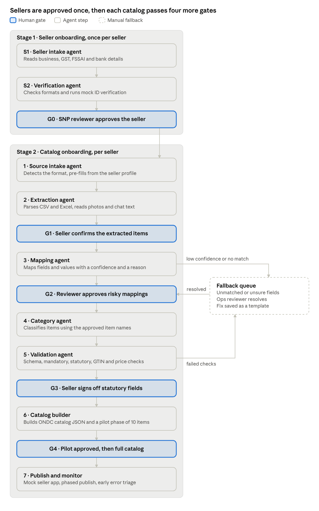
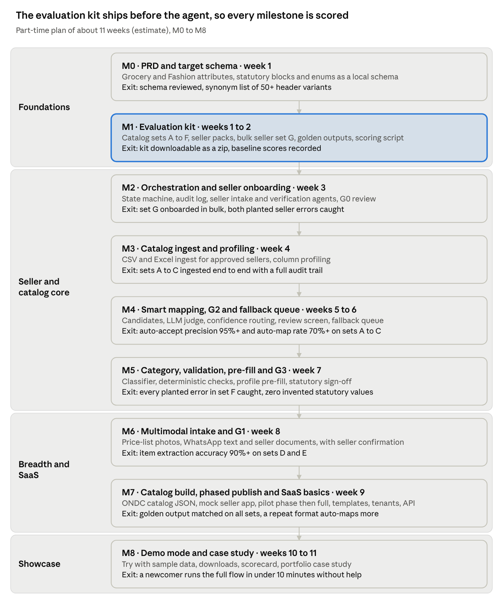

# PRD: Agentic Onboarding for ONDC Sellers

Nov 11, 2026 · @Abhijit Paul

## Overview

Agentic Onboarding for ONDC Sellers is an agentic onboarding flow that
first onboards small sellers onto a seller app, then turns each seller's
messy product list into an ONDC-ready retail catalog. Agents do the
extraction, mapping and checking, and a human approves every step that
carries legal or financial risk. It is a personal portfolio project
built only on public specifications and synthetic data, and it is not
affiliated with ONDC or any network participant.

**The problem.** Sellers do not connect to ONDC directly. They join
through a Seller Network Participant (SNP) app, which digitises their
catalog and pushes it to the network ([PhonePe
guide](https://business.phonepe.com/articles/what-is-ondc-a-complete-guide-for-small-businesses-and-sellers)).
Category and attribute completeness matter more than on a single
marketplace, because one listing is discovered across many buyer apps
([Fretron guide](https://www.fretron.com/guides/sell-on-ondc/)). Small
sellers still describe onboarding as long and complex, and the SNP
decides how much cataloguing help they get
([IDR](https://idronline.org/article/diversity-inclusion/making-ondc-accessible-for-women-led-small-enterprises/)).

**The case study.** A fictional SNP's catalog operations team today
re-keys catalogs by hand from sellers' Excel sheets, price-list photos
and WhatsApp messages. The goal is to cut the time from a seller's first
upload to a publish-ready catalog, without letting a wrong price, net
quantity or FSSAI number reach buyers.

**How it works, in one line.** The SNP first onboards the seller once
(business, GST, FSSAI and bank details, approved at gate G0). Then, for
each approved seller, the seller uploads whatever catalog they have,
agents extract, map, classify and validate it, humans approve at four
more gates, and the catalog is published to a mock seller app in phases.
For a spreadsheet catalog, classification runs after mapping and its
gate resolve each item’s real name, not before; for a photo or WhatsApp
catalog, extraction already gives each item a name, so classification
runs right after the seller confirms it.

**Origin.** The project extends a pattern the author shipped in a B2B
fulfillment platform: AI-suggested data mapping, human approval of
matches, and a manual fallback queue for anything unmatched. Here it is
rebuilt from first principles for a new domain, with no material from
any former employer.

## Problem statement and positioning

**Problem statement.** Small sellers and the SNPs that serve them lose
days between "I want to sell on ONDC" and a catalog that is live,
complete and compliant. Catalog data arrives in formats no system reads,
statutory fields are often missing, and SNP staff re-key it by hand. The
cost continues after onboarding: thin listings are hard to discover
across buyer apps, and a wrong MRP or missing legal detail puts the
listing and the seller at risk.

**What changes after onboarding**

| Who                   | Today                                                                  | With the product                                                                                  |
|-----------------------|------------------------------------------------------------------------|---------------------------------------------------------------------------------------------------|
| Seller                | Waits for someone to type the catalog, unsure what is legally required | Lists in one sitting from what they already have, and approves prices and legal fields themselves |
| SNP catalog ops       | Hand-keys every item for every seller                                  | Reviews only exceptions, with the reason shown                                                    |
| SNP business          | Slow activation and a high cost per onboarded seller                   | More sellers activated per ops person, with an audit trail for every value                        |
| Buyer apps and buyers | Inconsistent attributes, missing statutory details                     | Complete attributes and correct MRP and statutory information                                     |

**North-star metric:** time from a seller's first upload to their first
live, compliant listing. **Guardrail:** zero invented statutory values.

**Positioning options**

| Option                                         | Who pays                                                                                                                                                                                              | What they get                                                                                                                      | Verdict                              |
|------------------------------------------------|-------------------------------------------------------------------------------------------------------------------------------------------------------------------------------------------------------|------------------------------------------------------------------------------------------------------------------------------------|--------------------------------------|
| Feature inside one seller app                  | Nobody directly, it is an internal tool                                                                                                                                                               | Faster onboarding in that one app                                                                                                  | Simplest demo, weakest product story |
| Standalone B2B SaaS: catalog onboarding engine | SNPs, seller-enablement agencies (cataloguing is a funded activity under the MSME TEAM scheme, per [Drishti IAS summary](https://drishtiias.com/pdf/1738368912.pdf)), cooperative and FPO aggregators | API plus review console, ONDC schema pack, mapping templates, gate policies and audit log, priced per seller or per item onboarded | **Recommended for version 1**        |
| Horizontal multi-channel catalog mapper        | D2C brands and e-commerce agencies                                                                                                                                                                    | The same engine with more schema packs for other marketplaces                                                                      | Expansion path after version 1       |

**Decision.** Build version 1 as a standalone, multi-tenant B2B SaaS
with ONDC retail as the first schema pack. The demo stays focused on one
network, while the design shows a buyer, a pricing unit and a path to
more channels. This adds four requirements, FR-22 to FR-25, covering
workspaces per SNP, per-tenant gate thresholds, an upload and status
API, and usage metering.

**Network view.** Catalog quality is a network-level problem: today each
SNP solves it alone, with its own formats and its own manual effort. The
project therefore publishes its ONDC schema pack, evaluation kit and
scoring script openly, so any SNP can benchmark its own onboarding
against the same ground truth. Two network-level measures matter beyond
one SNP: the share of listings with complete statutory attributes, and
the median time from seller registration to first live listing.

**Beyond version 1: credit-ready sellers.** ONDC Financial Services is
already live, with credit disbursals reported on the network by June
2026 ([ONDC journey](https://ondc.org/pages/about-us.html)). Digital
transaction records can help sellers qualify for credit ([Bajaj Finserv
explainer](https://www.bajajfinserv.in/open-network-for-digital-commerce-ondc)),
and a seller verified at G0 with a clean catalog is the start of that
record. A possible Stage 3, not built in version 1, would package the
verified profile and early order history into a credit-readiness
summary, shared only with the seller's explicit consent and within RBI's
digital lending rules ([overview of lending on
ONDC](https://vinodkothari.com/2023/11/introducing-financial-services-on-ondc-opportunities-challenges-for-digital-lenders/)).

## Market analysis

The network has scale, but far fewer sellers are live in retail than
have been onboarded, and that gap is where seller and catalog onboarding
matters. Definitions differ across sources (all sellers versus retail,
onboarded versus live), so the figures below show direction rather than
an exact funnel.

**ONDC has named this problem itself.** Its Build for Bharat hackathon,
launched in January 2024 with Google, Antler, Protean and Paytm, listed
"Onboarding Sellers & Digitizing Catalog" as a retail problem statement
([ONDC blog](https://ondc.org/blog/build-for-bharat)).

**Network size**

| As of         | Metric                                                                              | Source                                                                                          |
|---------------|-------------------------------------------------------------------------------------|-------------------------------------------------------------------------------------------------|
| July 2026     | 500 million cumulative transactions                                                 | [ONDC journey](https://ondc.org/pages/about-us.html)                                            |
| July 2026     | More than 200,000 retail merchants active                                           | [Cross-Border Magazine](https://cross-border-magazine.com/ondc-500-million-transactions-india/) |
| June 2026     | About 500,000 sellers and about 9 million transactions a month (government figures) | [Cross-Border Magazine](https://cross-border-magazine.com/ondc-500-million-transactions-india/) |
| December 2025 | 1.16 lakh retail sellers live, from 630 cities and towns (government)               | [IANS](https://ianslive.in/over-116-lakh-retail-sellers-now-live-on-ondc-govt--20251216164816)  |
| Early 2025    | More than 7 lakh sellers onboarded, 72 seller apps                                  | [Policy Circle](https://www.policycircle.org/industry/ondc-faces-growth-pangs-e-commerce/)      |

**Who onboards sellers today**

| Player                                                                                                                                                                          | Type                         | What it offers, per its public material                                                                                                                                                                                   | Differentiation to test                                                      |
|---------------------------------------------------------------------------------------------------------------------------------------------------------------------------------|------------------------------|---------------------------------------------------------------------------------------------------------------------------------------------------------------------------------------------------------------------------|------------------------------------------------------------------------------|
| [Setu ONDC](https://setu.co/commerce/ondc/)                                                                                                                                     | API platform for aggregators | One-time seller onboarding, GST, PAN and bank verification, catalogue APIs ([docs](https://docs.setu.co/commerce/ondc/api-guide/seller-api))                                                                              | Agentic mapping from messy sources with explained confidence and human gates |
| [Fynd ONDC Seller App](https://fynd.com/ondc-seller-app)                                                                                                                        | Commerce platform extension  | Syncs a brand's catalog from Fynd Commerce to ONDC guidelines                                                                                                                                                             | Works for sellers with no existing digital catalog                           |
| [Shiprocket seller app](https://startup2.outlookindia.com/sector/e-commerce/shiprocket-seller-app-to-facilitate-seamless-merchant-onboarding-and-integration-on-ondc-news-8747) | Logistics-led seller app     | Among the larger seller apps, with more than 10,000 sellers in 2024 ([Business Standard](https://business-standard.com/industry/news/with-open-arms-how-far-can-ondc-democratise-ecommerce-in-india-124080101679_1.html)) | Embeddable onboarding layer rather than a competing seller app               |
| [ERPNext ONDC Seller App](https://frappe.io/incubator/project/ONDC%20Seller%20App)                                                                                              | ERP integration              | Publishes catalogue and business profile from ERPNext                                                                                                                                                                     | Sellers without an ERP                                                       |
| [ONDC reference seller app](https://github.com/ONDC-Official/seller-app-sdk)                                                                                                    | Open-source reference        | Baseline seller app for network participants                                                                                                                                                                              | Onboarding intelligence on top of any seller app                             |
| ONDC Sahayak WhatsApp bot                                                                                                                                                       | Assisted onboarding          | Onboarding help in five languages ([Drishti IAS summary](https://drishtiias.com/pdf/1738368912.pdf))                                                                                                                      | Turns the conversation into a validated catalog                              |

**AI cataloguing tools and similar projects** (public material reviewed
November 2026)

| Player                                                                                                                                      | Type                                    | What it offers, per its public material                                                                       |
|---------------------------------------------------------------------------------------------------------------------------------------------|-----------------------------------------|---------------------------------------------------------------------------------------------------------------|
| [SellerApp ONDC Listing Builder](https://www.sellerapp.com/ondc)                                                                            | Seller app, with Google Cloud           | Enriched catalog from key attributes using generative AI                                                      |
| [Mystore AI Catalog Tool](https://www.mystore.in/en/blog/5-ways-mystore-ai-catalog-tool-speeds-up-your-ondc-network-presence)               | ONDC seller app                         | AI-written titles and descriptions for ONDC listings                                                          |
| [Fynd AI PIM](https://www.fynd.com/blog/most-indian-msmes-think-ai-isn-t-for-them-here-s-why-that-s-costing-them-sales)                     | Commerce platform                       | A marketplace-ready listing from one product photo                                                            |
| [Shiprocket Shunya.ai](https://www.newsbytesapp.com/news/science/shiprocket-unveils-multimodal-ai-platform-shunyaai/tldr)                   | AI in a seller panel                    | Bilingual listings, GST-ready invoices, WhatsApp voice orders                                                 |
| [BharatGen e-vikrAI](https://analyticsindiamag.com/ai-news-updates/bharatgen-launches-e-vikrai-vision-language-model-for-indic-e-commerce/) | Government-backed vision language model | Titles, descriptions and pricing suggestions from product images                                              |
| [CatalogCraft](https://github.com/exploring-solver/CatalogCraft)                                                                            | Build for Bharat prototype              | Catalog digitisation goals; no review gates or evaluation data listed                                         |
| [catalog-scoring-ondc](https://github.com/adityacodes30/catalog-scoring-ondc)                                                               | ONDC hackathon entry                    | Scores catalog quality on demand                                                                              |
| [VyapaarSetu AI](https://jenilrupapara.vercel.app/projects/vyapaarsetu-ai)                                                                  | Personal project                        | Photo-to-listing, Indic voice, an autonomous cataloging agent; no human review or evaluation method described |

These tools and projects focus on creating or enriching listings from
photos or attributes. None of the public material reviewed describes
mapping a seller's existing files with an explained confidence per
field, human gates for statutory values, seller verification before
cataloguing, a public evaluation kit with ground truth, or a run-once
cache for agent results. Those five points are this product's
differentiation.

**Where this product fits.** It is positioned as the trust and
evaluation layer for seller onboarding that seller apps embed, not as
another seller app or another AI listing generator. With roughly 70
seller apps on the network, the buyer count is small, so pricing has to
follow volume (per seller or per item onboarded), and seller-enablement
agencies are a second buyer.

**Next steps for the analysis**

- [ ] Onboard dataset B through two public seller apps and time each
  step, as a competitive teardown.

- [ ] Interview three to five SNP catalog ops leads on time per seller,
  rejection reasons and tooling.

- [ ] Confirm current seller-app count and live-seller figures from an
  official ONDC or government source.

## Users and personas

Four people touch the flow. Two are humans in the loop, one is the
seller, and one is the outsider testing the demo.

| Persona              | Who they are (fictional)                                                                                            | What they need                                                                                      | Where they act                                 |
|----------------------|---------------------------------------------------------------------------------------------------------------------|-----------------------------------------------------------------------------------------------------|------------------------------------------------|
| Seller               | Meena runs a home-made pickles and spices business in Nashik and keeps her price list in a notebook and on WhatsApp | List products without learning a catalog format, and stay in control of prices and legal details    | Seller details, catalog upload, Gate 1, Gate 3 |
| Catalog ops reviewer | Works at the SNP and onboards 20 to 30 sellers a week                                                               | Review only what the agent is unsure about, with the reason and the source value shown side by side | Gate 0, Gate 2, fallback queue, Gate 4         |
| SNP onboarding lead  | Owns seller activation numbers for the SNP                                                                          | Faster time to first live listing, fewer rejected catalogs, an audit trail                          | Dashboard, Gate 4 policy                       |
| Evaluator            | A hiring manager, engineer or another PM trying the demo                                                            | Run the whole flow on sample data in minutes and see how it scores                                  | Demo mode, eval kit download                   |

## Goals, non-goals and success metrics

Version 1 succeeds if a 50-item catalog goes from raw upload to
publish-ready in under 30 minutes, including human review, with no
invented value in any statutory field.

**Goals**

1.  Onboard each seller once and reuse the verified profile to pre-fill
    every catalog they add. Accept the catalog formats small sellers
    actually have: CSV, Excel, a photo of a price list, and
    WhatsApp-style text.

2.  Map seller data to ONDC retail item attributes with an explained
    confidence score for every field.

3.  Keep humans in charge of anything legal or financial, and send
    everything the agent cannot resolve to a fallback queue.

4.  Ship a downloadable evaluation kit so anyone can test the flow and
    reproduce the scores.

**Non-goals for version 1**

- Registering on the live ONDC network, or any order, payment,
  settlement or logistics flow.

- Categories beyond Grocery and Fashion.

- Real seller data. The demo runs on synthetic catalogs only.

- Voice input and regional-language UI, which are planned for later.

- Live model calls in the case-study demo. Agent steps are replayed from
  pre-computed outputs and labelled as simulated on screen, while
  deterministic checks (GSTIN checksum, GTIN check digit, MRP versus
  price, required fields) run as real code.

**Success metrics** (targets, measured on the evaluation kit)

| Metric                    | Definition                                                                 | Target                 |
|---------------------------|----------------------------------------------------------------------------|------------------------|
| Auto-accept precision     | Share of auto-accepted field mappings that match ground truth              | 95% or higher          |
| Auto-map rate             | Share of fields mapped with no human edit                                  | 70% or higher          |
| Statutory gap recall      | Share of missing or invalid mandatory fields that get flagged              | 100%                   |
| Invented statutory values | Statutory values with no trace to the source data                          | 0                      |
| Fallback queue rate       | Share of fields routed to manual resolution                                | Under 15%              |
| Time to publish-ready     | 50-item catalog, upload to Gate 4 approval, simulated review time included | Under 30 minutes       |
| Template lift             | Gain in auto-map rate on a second seller with the same source format       | Plus 10 points or more |

## End-to-end agentic flow

The flow runs in two stages under one orchestrator. Stage 1 onboards
each seller once through two agents and gate G0. Stage 2 runs seven
agents and four more gates for that seller's catalog, and repeats
whenever the seller adds a new catalog. The orchestrator is a state
machine, so the flow can wait at a gate for days and resume exactly
where it stopped.

agentic onboarding flow · 2 stages, 9 agents, 5 human gates, 1 fallback
queue

Work moves past a highlighted gate only after a person approves it.
Anything the mapping or validation agent cannot resolve goes to the
fallback queue and comes back through G2. For a photo or WhatsApp
catalog, the category agent runs straight after G1, because extraction
already gives each item a name.

## Human gates

Five gates stop the flow until a named person approves, and nothing is
ever published by default. The rule behind them: agents may extract,
suggest and check, but a human owns every value that is legal, financial
or customer-facing at scale.

| Gate                    | Runs after                    | Approver              | What they approve                                                                                                                       | Rule                                                                                                                                                                                                                                                                                  |
|-------------------------|-------------------------------|-----------------------|-----------------------------------------------------------------------------------------------------------------------------------------|---------------------------------------------------------------------------------------------------------------------------------------------------------------------------------------------------------------------------------------------------------------------------------------|
| G0 Seller approved      | Seller verification (Stage 1) | SNP reviewer          | Seller profile: business details, GSTIN, FSSAI licence, bank details, fulfilment and return terms                                       | Always required, once per seller. Catalog onboarding cannot start until G0 passes.                                                                                                                                                                                                    |
| G1 Extraction confirmed | Extraction                    | Seller                | The item list as the agent read it: names, prices, quantities                                                                           | Always required for photo and text sources. For CSV and Excel, shown only when the parser hit errors.                                                                                                                                                                                 |
| G2 Mapping review       | Smart mapping                 | Catalog ops reviewer  | Medium-confidence mappings and every high-risk mapping                                                                                  | Low-risk mappings at 0.90 or above are auto-accepted and listed for spot-check.                                                                                                                                                                                                       |
| G3 Statutory sign-off   | Validation                    | Seller                | Net quantity, MRP, manufacturer or packer, month and year of packing, FSSAI licence, veg or non-veg mark, return and cancellation terms | Always required. The agent may only extract these from the source or the approved seller profile, or ask for them, never invent them. For items carrying another company's brand, the seller enters the pack-label details once per brand and they apply to every item of that brand. |
| G4 Publish approval     | Catalog build                 | Reviewer, then seller | A pilot phase of 10 items first, then the full catalog                                                                                  | The full catalog publishes only after the pilot phase passes on the mock seller app.                                                                                                                                                                                                  |

**How gates behave**

- Every gate can send work back to the previous agent with a reason.
  Reasons are logged and become new test cases in the evaluation kit.

- A gate shows the source value, the proposed value, the confidence and
  the agent's one-line reason side by side.

- If a seller does not respond within 48 hours, the flow sends one
  reminder and then waits. It never times out into a publish.

- Every approval, edit and rejection is written to an audit log with
  who, what and when.

## AI-assisted smart mapping

Smart mapping decides, for each seller column and value, which ONDC item
attribute it belongs to and in what normalised form. Deterministic rules
go first and the LLM handles what rules cannot, so every decision is
explainable and cheap.

**Target schema.** The target is a local JSON schema built in M0 from
ONDC's public retail specs: item attributes, the category list, enums,
and the statutory blocks for packaged commodities and prepackaged food
that apply to most Grocery categories ([ONDC retail category
sheet](https://docs.google.com/spreadsheets/d/1APAvavF_BNbTA89benAlGtv0GuFvpn2b6XXi4lSdTTw),
[retail
enums](https://github.com/ONDC-Official/protocol-network-extension/tree/main/enums/retail)).
It also covers catalog terms such as time to ship, cancellable,
returnable and return period ([example integration
notes](https://auperator.atlassian.net/wiki/spaces/POE/pages/4062838814/ONDC+integration)).

**Pipeline**

1.  **Profile.** For each source column, record type, fill rate,
    distinct values and five sample values.

2.  **Generate candidates.** Match headers against a synonym list
    ("MRP", "M.R.P", "Max Rate"), fuzzy string match, and embeddings of
    the header plus its sample values. Keep the top three candidates.

3.  **Judge.** The LLM picks one candidate or none, gives a confidence
    from 0 to 1, and writes a one-line reason that must quote at least
    one sample value.

4.  **Normalise values.** Units, prices, sizes and colours are converted
    to schema form. Rules first, LLM only for free text.

5.  **Route.** Each mapping is routed by its confidence and its field's
    risk class (table below).

6.  **Learn.** Approved mappings are saved as a template per source
    format, such as a Vyapar export or a Shopify export, so the next
    seller with that format starts pre-mapped.

**Routing by confidence and risk**

| Risk class | Example fields                                                                              | 0.90 and above                     | 0.60 to 0.89 | Below 0.60 or no match  |
|------------|---------------------------------------------------------------------------------------------|------------------------------------|--------------|-------------------------|
| Low        | Name, description, brand, colour                                                            | Auto-accept, listed for spot-check | G2 review    | Fallback queue          |
| Medium     | Category, size, weight, dimensions, images                                                  | G2 review, pre-filled              | G2 review    | Fallback queue          |
| High       | Selling price, MRP, net quantity, FSSAI licence, manufacturer, veg or non-veg, return terms | G2 and G3                          | G2 and G3    | Fallback queue, then G3 |

**Value normalisation examples**

| Seller wrote                    | Becomes                                                 | Handled by          |
|---------------------------------|---------------------------------------------------------|---------------------|
| "Rs. 120/-", "₹120.00"          | Price 120.00 INR                                        | Rule                |
| "500gm", "0.5 kg", "aadha kilo" | Net quantity 500 g                                      | Rule, LLM for words |
| "Lal", "maroon-ish"             | Colour from the ONDC enum                               | LLM, then G2        |
| "XL / 42"                       | Size XL, chest 42 in                                    | Rule, then G2       |
| "Mango pickle 400g jar"         | Grocery category from the ONDC list, net quantity 400 g | Classifier and rule |

A value that neither the rules nor the model can normalise, such as an
unusual quantity or date format, is kept as the seller wrote it and
routed to the fallback queue. It is never passed on as a blank or a
guessed number.

**Guardrails**

- The LLM never invents a statutory value. If the source does not
  contain it, the field is flagged and the seller is asked at G3.

- GTIN check digits, MRP at or above selling price, and required-field
  presence are checked by code, not by the model.

- Generated descriptions may only restate facts present in the source.
  Claims such as "organic" or "handmade" need a source value behind
  them.

**Seller profile pre-fill.** Values taken from the seller profile
approved at G0 (packer name and address, FSSAI licence, return terms,
time to ship) count as sourced, so the agent can pre-fill them, and the
seller still confirms them at G3. The profile lists the seller's own
brands. An item that is unbranded or carries one of those brands counts
as self-packed and is pre-filled from the profile. An item carrying
another company's brand is never pre-filled with the seller's details:
it raises a missing-packer issue at G3, the seller copies the brand
owner's packer name, address and FSSAI licence from the label once per
brand, and the catalog builder refuses to build if any of these are
still missing.

**Run once, replay after.** In production, each agent step calls the
model only the first time it sees a given input. Its output is stored
under a cache key made of a SHA-256 hash of the normalised input, the
step name, the prompt version, the target schema version and the model
ID. When the same data comes back (a seller re-uploads an unchanged
file, an evaluator re-runs a sample set, the demo replays), the stored
output is reused with no model call. Changing the prompt, schema or
model changes the key, so stale results are never replayed. Human
decisions at the gates are never cached: they are recorded per run, and
approved mappings become templates as described above.

| Layer              | Keyed by                                                          | Reused when                                | Saves                                |
|--------------------|-------------------------------------------------------------------|--------------------------------------------|--------------------------------------|
| Step output cache  | Hash of normalised input, step, prompt, schema and model versions | The exact same input reaches the same step | The whole model call                 |
| Column-level cache | Hash of header plus sample values                                 | A new file repeats a column already seen   | The mapping call for that column     |
| Mapping templates  | Source format, such as a Vyapar or Shopify export                 | A new seller uses a known format           | Most mapping calls, plus review time |

## Evaluation and dummy data kit

The evaluation kit is built in M1, before the agent, so every later
milestone is scored against the same ground truth. The same files power
the demo, and anyone can download them to test the flow or reproduce the
scores.

**Datasets** (all synthetic, all businesses fictional)

| Set | Seller and format                                                                                        | Items                    | What it tests                                    |
|-----|----------------------------------------------------------------------------------------------------------|--------------------------|--------------------------------------------------|
| A   | Spice and pickle maker, clean CSV                                                                        | 40                       | Baseline mapping on tidy data                    |
| B   | Kirana store, messy Excel with Hindi-English headers, merged cells and units inside text                 | 60                       | Header synonyms, unit and price normalisation    |
| C   | Apparel boutique, Shopify-style CSV export with size and colour variants                                 | 30 products, 84 variants | Variant handling, size and colour enums          |
| D   | Home bakery, WhatsApp-style text catalog                                                                 | 25                       | Free-text extraction, G1 confirmation            |
| E   | Sweet shop, photo of a handwritten price list                                                            | 20                       | Multimodal extraction, G1 confirmation           |
| F   | Trap catalog: invalid GTINs, MRP below price, missing FSSAI, duplicate SKUs, an invented "organic" claim | 30                       | Validation recall and the no-invention guardrail |

**Seller onboarding packs.** Each catalog set A to F comes with a seller
pack: a filled registration form, fake GST and FSSAI certificates as
images, and a cancelled-cheque image with a fake account. A seventh set,
G, is a bulk CSV of 12 sellers from a fictional women-led food
cooperative, with two planted errors (an invalid GSTIN checksum and an
expired FSSAI licence) to test bulk seller onboarding and G0.

**Kit versions**

| Version | Change                                                                                                                                                                                                                            |
|---------|-----------------------------------------------------------------------------------------------------------------------------------------------------------------------------------------------------------------------------------|
| v1.2    | Every seller registration form lists the seller's own brands, so own-brand items count as self-packed                                                                                                                             |
| v1.1    | Set B: items carrying another company's brand now hold the brand owner's packer name, address and FSSAI licence. Added brand_owner_labels.json (the pack-label details) and g3_expected.json (values the seller must enter at G3) |
| v1.0    | First release: sets A to G, seller packs, ground truth, scoring script                                                                                                                                                            |

**What each set ships with**

- The raw seller file as the seller would send it.

- A seller profile in JSON: store name, city, categories, fulfilment
  mode.

- Ground-truth field mappings and normalised values in JSON.

- The golden ONDC catalog output the flow should produce.

- A list of planted errors with the gate that should catch each one (set
  F, plus a few in B and C).

**Download options in the app**

- **Try with sample data.** One click picks a set, fills in the seller
  profile and runs the flow in demo mode, with the evaluator approving
  gates in both roles.

- **Download a single set.** Raw file plus its ground truth, for someone
  who wants to upload it themselves.

- **Download the full kit (.zip).** All seven sets with their seller
  packs, the scoring script, a README and the license.

- **Scorecard.** After any run, a page compares the agent's output with
  the golden output and shows the success metrics for that run.

**Rules for the synthetic data**

- Brand, store and person names are invented and checked against a quick
  web search so none matches a real business.

- GTINs carry valid check digits but use the GS1 restricted-circulation
  prefix range, so they cannot collide with real retail products.

- FSSAI licence numbers, GSTINs, phone numbers and addresses use
  obviously fake patterns and are labelled as test data in the README.

- Price-list photos are generated or hand-written for the project, never
  photographed from a real shop.

- The kit is released under CC BY 4.0 and the scoring script under the
  MIT license.

## Functional requirements

P0 items make up the version 1 demo, P1 items finish the case study, and
P2 items are stretch goals.

| ID    | Requirement                                                                                                                                                                                                        | Priority | Milestone |
|-------|--------------------------------------------------------------------------------------------------------------------------------------------------------------------------------------------------------------------|----------|-----------|
| FR-01 | SNP adds a seller one at a time or in bulk from a CSV                                                                                                                                                              | P0       | M2        |
| FR-02 | Seller intake agent fills the seller profile from a registration form: business, address, GST, FSSAI, bank, fulfilment and return terms                                                                            | P0       | M2        |
| FR-03 | Verification agent checks formats (GSTIN checksum, FSSAI licence pattern and expiry, IFSC pattern) and runs mock ID verification                                                                                   | P0       | M2        |
| FR-04 | G0 review screen to approve, reject or request changes, with a reason                                                                                                                                              | P0       | M2        |
| FR-05 | Orchestrator runs both stages as a state machine that can pause at any gate and resume                                                                                                                             | P0       | M2        |
| FR-06 | Every agent decision and human action is written to an audit log                                                                                                                                                   | P0       | M2        |
| FR-07 | For an approved seller, upload a CSV or Excel catalog, or start from a sample dataset                                                                                                                              | P0       | M3        |
| FR-08 | Profile every column: type, fill rate, distinct values, samples                                                                                                                                                    | P0       | M3        |
| FR-09 | Map fields with top-three candidates, a confidence score and a reason quoting a sample value                                                                                                                       | P0       | M4        |
| FR-10 | Route mappings by confidence and risk class to auto-accept, G2 or the fallback queue                                                                                                                               | P0       | M4        |
| FR-11 | G2 review screen shows source value, proposed value, confidence and reason, with accept, edit and reject                                                                                                           | P0       | M4        |
| FR-12 | Fallback queue for unmatched fields, with resolution feeding back into G2                                                                                                                                          | P0       | M4        |
| FR-13 | Classify each item into an ONDC Grocery or Fashion category (after mapping and G2 for a spreadsheet catalog, since classification needs each item’s resolved name; right after G1 for a photo or WhatsApp catalog) | P0       | M5        |
| FR-14 | Deterministic checks: schema validity, mandatory and statutory fields, GTIN check digit, MRP versus price, duplicates                                                                                              | P0       | M5        |
| FR-15 | Pre-fill catalog fields from the approved seller profile                                                                                                                                                           | P0       | M5        |
| FR-16 | G3 statutory sign-off for the seller, with missing fields asked as plain questions                                                                                                                                 | P0       | M5        |
| FR-17 | Extract items from a price-list photo and from WhatsApp-style text, then confirm at G1                                                                                                                             | P1       | M6        |
| FR-18 | Extract seller details from GST and FSSAI certificate images and a cancelled cheque                                                                                                                                | P1       | M6        |
| FR-19 | Build the ONDC catalog JSON and publish to a mock seller app                                                                                                                                                       | P0       | M7        |
| FR-20 | Phased publish: pilot phase of 10 items, G4 approval, then the full catalog                                                                                                                                        | P0       | M7        |
| FR-21 | Save approved mappings as a template per source format and reuse them                                                                                                                                              | P1       | M7        |
| FR-22 | Workspace per SNP tenant, holding its sellers, catalogs, templates and users                                                                                                                                       | P1       | M7        |
| FR-23 | Per-tenant gate policy: confidence thresholds and which fields count as high risk                                                                                                                                  | P1       | M7        |
| FR-24 | REST API to create sellers, upload catalogs and read onboarding status                                                                                                                                             | P1       | M7        |
| FR-25 | Usage metering per seller and per item onboarded, as the pricing unit                                                                                                                                              | P2       | M7        |
| FR-26 | Demo mode, single-set download, full kit download and scorecard page                                                                                                                                               | P0       | M8        |
| FR-27 | Scoring script runnable from the command line against any run's output                                                                                                                                             | P0       | M1        |
| FR-28 | Hindi labels for seller-facing screens                                                                                                                                                                             | P2       | Later     |

## Non-functional requirements, privacy and IP safety

The project must be safe to show publicly: synthetic data, public specs,
original code, and nothing from a former employer.

**Quality and cost**

- Explainability: no mapping is shown without its reason and source
  sample.

- Cost: under USD 0.50 in model calls for a first run of a 50-item
  catalog, and close to zero for any repeat run of the same data, served
  from the step output cache (target).

- Latency: agent work for a 50-item catalog finishes in under 3 minutes,
  excluding human review time (target).

- Reproducibility: the same input and model version give the same
  routing, so eval scores are stable.

**Privacy**

- The public demo accepts sample data only. If uploads of real files are
  ever enabled, they are processed in-session, deleted within 24 hours
  and never used for templates, in line with the spirit of India's
  Digital Personal Data Protection Act, 2023.

- Logs redact phone numbers, addresses, GSTINs, bank details and licence
  numbers. Seller documents in the demo are synthetic, and any
  real-upload path never accepts bank or identity documents.

**IP and confidentiality**

- No names, screenshots, schemas, field lists, documents or metrics from
  Tradebyte or any other former employer.

- No real ONDC participant, seller app or brand is named as a partner or
  user.

- ONDC specs are referenced and linked rather than copied wholesale.
  Their license terms are checked in M0 before any schema extract is
  published in the repo.

- All code is original. Only open-source libraries under permissive
  licenses such as MIT or Apache 2.0 are used.

- The README states that this is a personal project with no affiliation
  to ONDC.

## Milestones

Nine milestones over about 11 part-time weeks, each built PRD-first and
closed only when its exit criterion passes on the evaluation kit.

milestone plan · M0 to M8, about 11 weeks part-time

M1 comes before any agent code, so every later milestone has a score to
beat. Week counts are estimates to revisit after M1.

## Risks and open questions

The biggest risk is a flattering demo: clean synthetic data and a mock
seller app can inflate scores, so the kit is built messy on purpose and
scores are reported per dataset.

| Risk                                             | Impact                                                      | Mitigation                                                                  |
|--------------------------------------------------|-------------------------------------------------------------|-----------------------------------------------------------------------------|
| The LLM invents a statutory value                | Legal risk for the seller, credibility loss for the project | No-invention guardrail, planted traps in set F, G3 always required          |
| Synthetic data is cleaner than real catalogs     | Inflated scores                                             | Messy sets B, D and E, error injection, per-set scores on the scorecard     |
| ONDC specs change, or their license limits reuse | Schema pack goes stale or cannot be published               | Pin spec versions in M0, link rather than copy, recheck before each release |
| Handwriting extraction is weak                   | G1 overloads the seller                                     | Keep photo intake at P1, show low-confidence items first                    |
| Scope creep into credit or more categories       | The demo slips                                              | Stage 3 and extra categories stay out of version 1                          |
| A mock seller app hides real network behaviour   | Weaker credibility                                          | Validate output with ONDC's public tools where access allows                |
| A fictional name matches a real business         | IP complaint                                                | Web search check on every name before release                               |
| Public demo runs up model costs                  | Unplanned spend                                             | Sample data only, cached demo runs, rate limits and a monthly cap           |

**Open questions**

- [ ] Which license covers ONDC's spec repositories, and can a schema
  extract live in a public repo?

- [ ] Can catalog output be checked against ONDC's staging reference
  apps or log verification tool without registering as a network
  participant?

- [ ] Does a descriptive title that uses "ONDC" need anything beyond the
  no-affiliation note in the README?

- [ ] Which third category comes after Grocery and Fashion: Home and
  Kitchen, or Beauty and Personal Care?

- [ ] Which model and hosting setup for the public demo, and what
  monthly cost cap?

## References

- [ONDC Official on GitHub](https://github.com/ONDC-Official):
  specifications, reference apps and log verification tools

- [ONDC retail
  specifications](https://github.com/ONDC-Official/ONDC-RET-Specifications)

- [ONDC retail
  enums](https://github.com/ONDC-Official/protocol-network-extension/tree/main/enums/retail)

- [ONDC retail category and statutory requirement
  sheet](https://docs.google.com/spreadsheets/d/1APAvavF_BNbTA89benAlGtv0GuFvpn2b6XXi4lSdTTw)

- [ONDC tech quickstart
  guide](https://github.com/ONDC-Official/developer-docs/blob/main/Tech_Quickstart_Guide.md)

- [ONDC journey and network
  milestones](https://ondc.org/pages/about-us.html)

- [What is ONDC: a guide for small sellers,
  PhonePe](https://business.phonepe.com/articles/what-is-ondc-a-complete-guide-for-small-businesses-and-sellers)

- [How to sell on ONDC in India,
  Fretron](https://www.fretron.com/guides/sell-on-ondc/)

- [Making ONDC accessible for women-led small enterprises,
  IDR](https://idronline.org/article/diversity-inclusion/making-ondc-accessible-for-women-led-small-enterprises/)

- [ONDC and MSME TEAM scheme summary, Drishti
  IAS](https://drishtiias.com/pdf/1738368912.pdf)

- [ONDC integration notes with catalog MVP
  attributes](https://auperator.atlassian.net/wiki/spaces/POE/pages/4062838814/ONDC+integration)

- [ONDC explainer with financial services, Bajaj
  Finserv](https://www.bajajfinserv.in/open-network-for-digital-commerce-ondc)

- [Financial services on ONDC for digital lenders, Vinod Kothari
  Consultants](https://vinodkothari.com/2023/11/introducing-financial-services-on-ondc-opportunities-challenges-for-digital-lenders/)

<!-- -->

- [Build for Bharat hackathon, ONDC
  blog](https://ondc.org/blog/build-for-bharat)
